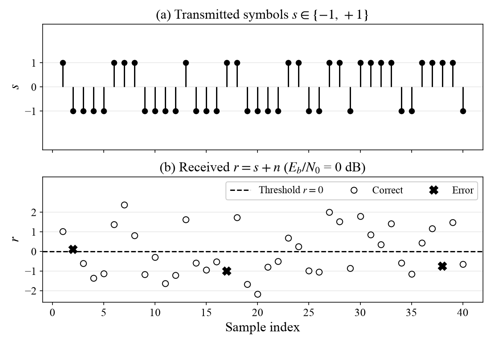
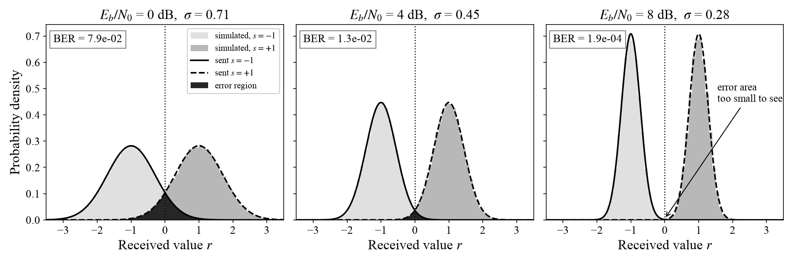
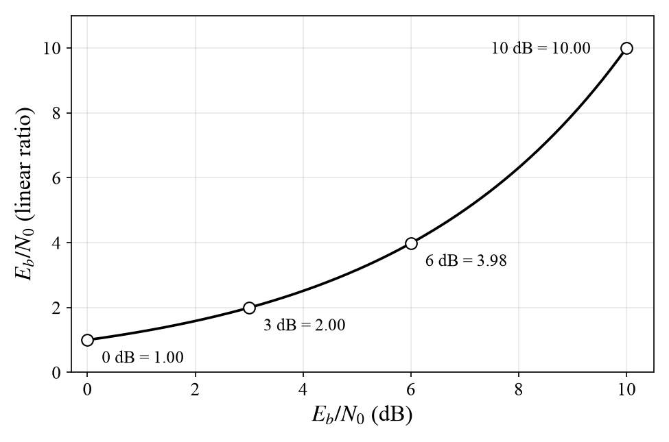
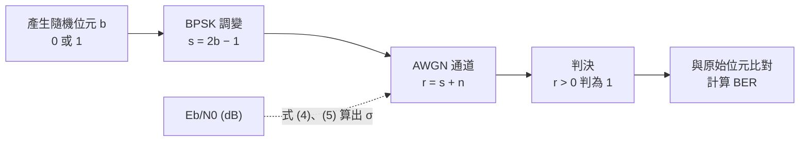
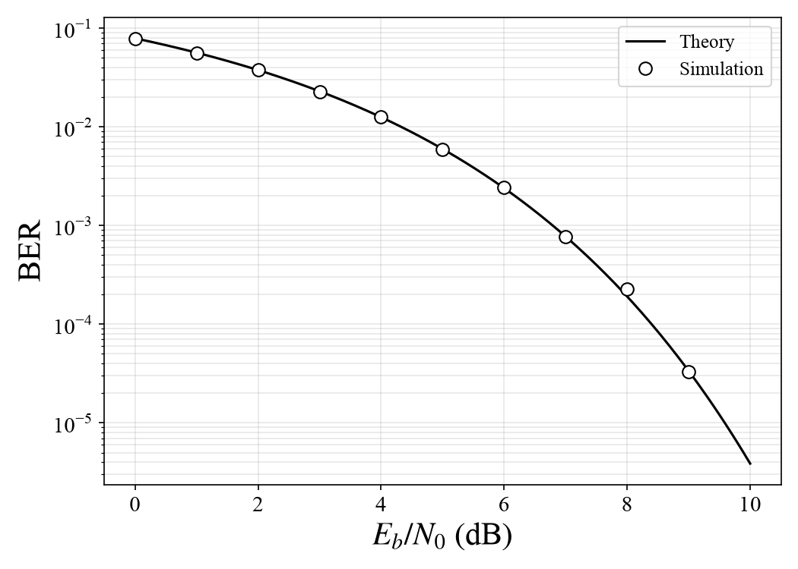

# 實作筆記 01｜BPSK 在 AWGN 通道下的位元錯誤率模擬

:::info
- 目標：以 Python 模擬 BPSK 在 AWGN 通道下的位元錯誤率，並與理論值比對。
- 先備知識：Linux 終端機基本操作，不需通訊背景。
- 程式：GitHub `hhh1715/handson` 的 `01_bpsk_ber/` 資料夾
- 驗證環境：Ubuntu 22.04、uv 0.13.7、Python 3.10
:::

---

## 1. 前言

數位通訊傳送的是位元 (bit)，也就是 0 與 1。位元從傳送端經過空氣或纜線到達接收端的途中會混入雜訊 (noise)，接收端因此可能把 0 判為 1，或把 1 判為 0。

位元錯誤率 (Bit Error Rate, BER) 是判錯的位元占全部傳送位元的比例：

$$
\text{BER} = \frac{N_{\text{error}}}{N_{\text{total}}} \tag{1}
$$

其中 $N_{\text{error}}$ 為判錯的位元數，$N_{\text{total}}$ 為傳送的位元總數。例如傳送 1,000,000 個位元、判錯 78,500 個，BER 即為 $7.85 \times 10^{-2}$。

論文比較不同傳輸方式的效能時，常以 BER 對訊號與雜訊強度比值的曲線呈現。本筆記以最簡單的 BPSK 調變為例，由接收值的分布推導 AWGN 通道下的理論 BER，再以 Python 模擬驗證。

---

## 2. 傳輸模型

### 2.1 BPSK 調變

位元無法直接在空氣中傳送，必須先轉成電壓或電波。把位元轉成可傳送訊號的過程稱為調變 (modulation)，轉換後的每一個值稱為符號 (symbol)。

二進位相移鍵控 (Binary Phase Shift Keying, BPSK) 是最簡單的調變方式：位元 0 送 $-1$，位元 1 送 $+1$。實際系統中，$+1$ 與 $-1$ 分別對應載波相位 0° 與 180°，相移鍵控的名稱由此而來；模擬時只需要 $\pm 1$ 兩個數值。以 $b$ 表示位元、$s$ 表示符號：

$$
s = 2b - 1, \quad b \in \{0, 1\},\ s \in \{-1, +1\} \tag{2}
$$

### 2.2 AWGN 通道

訊號從傳送端到接收端所經過的路徑稱為通道 (channel)。電子元件的熱擾動等因素會在通道中產生隨機的雜訊 $n$，接收端收到的值 $r$ 是符號與雜訊的和：

$$
r = s + n \tag{3}
$$

最常用的雜訊模型是加成性白高斯雜訊 (Additive White Gaussian Noise, AWGN)，名稱中的三個詞各描述一個性質：

- **加成性 (additive)**：雜訊直接加在訊號上，如式 (3)。
- **白 (white)**：雜訊在各頻率的強度相同，在模擬中對應為各符號的雜訊彼此獨立。
- **高斯 (Gaussian)**：雜訊的值服從高斯分布，也稱常態分布 (normal distribution)。高斯分布呈鐘形，接近 0 的值出現機率最高，離 0 越遠機率越低。

高斯雜訊的平均為 0，大小由標準差 (standard deviation) $\sigma$ 決定。約 68% 的雜訊落在 $\pm\sigma$ 之內，約 95% 落在 $\pm 2\sigma$ 之內。$\sigma$ 越大，雜訊越強。

### 2.3 判決規則

接收端只看得到 $r$，看不到原本的 $s$，因此需要一條判決規則 (decision rule)：

- $r > 0$：判為位元 1
- $r \le 0$：判為位元 0

判決門檻 0 為 $-1$ 與 $+1$ 的中點，兩種符號被雜訊推過門檻的機率相同。送 $-1$ 時，雜訊 $n > 1$ 會造成判錯；送 $+1$ 時，$n < -1$ 會造成判錯。


> **圖 1**　連續 40 個位元的傳送與接收（$\sigma = 0.71$）
> - (a) 傳送端送出的符號 $s$。
> - (b) 接收端收到的 $r = s + n$。虛線為判決門檻 0；空心圓為判對的點，叉號為判錯的點。

圖 1(b) 中，收到的值分布在 $\pm 1$ 附近，多數位元的 $r$ 與 $s$ 同號，例如第 1 個位元送 $+1$、收到約 $1.0$。第 2 個位元送 $-1$，收到的值大於 0，判為位元 1；第 17 與第 38 個位元送 $+1$，收到的值小於 0，判為位元 0。

### 2.4 接收值的分布

將傳送的位元數增加到 200,000 個，並以直方圖 (histogram) 統計 $r$ 的分布：橫軸切成許多小區間，縱軸為落在每個區間的點所占的比例。點數夠多時，直方圖的外形接近理論的機率密度 (probability density) 曲線；曲線下某段範圍的面積，即為 $r$ 落在該範圍的機率。


> **圖 2**　三種雜訊強度下收到值 $r$ 的分布
> - 淺灰與深灰為送 $-1$ 與送 $+1$ 的模擬直方圖，實線與虛線為對應的理論高斯分布，曲線高度乘以 1/2，對應位元 0 與 1 各占一半。
> - 黑色區域為越過門檻 0 的部分，左上角標示其面積總和。
> - 子圖標題標示 $E_b/N_0$ 與 $\sigma$。$E_b/N_0$ 為訊號與雜訊強度的比值，數值越大表示雜訊越小。

收到的 $r$ 形成兩個鐘形分布，中心分別位於 $-1$ 與 $+1$。送 $-1$ 的分布越過 0 的部分與送 $+1$ 的分布越過 0 的部分即為判錯的機率，兩塊黑色面積相加等於 BER。由左至右，$\sigma$ 從 0.71 降到 0.28，分布變窄，越過 0 的面積隨之縮小，BER 從 $7.9 \times 10^{-2}$ 降到 $1.9 \times 10^{-4}$。最右圖的黑色面積在圖上無法辨識，但不為零。

因此 BPSK 的 BER 由雜訊標準差 $\sigma$ 與符號到門檻的距離 1 之比值決定。

---

## 3. 理論 BER 推導

### 3.1 每位元訊雜比 Eb/N0

數位通訊以 $E_b/N_0$ 描述訊號相對於雜訊的強度：

- **每位元能量 (energy per bit) $E_b$**：傳送一個位元所用的能量。BPSK 的符號為 $\pm 1$，能量為 $s^2 = 1$，一個符號帶一個位元，因此 $E_b = 1$。
- **雜訊功率頻譜密度 (noise power spectral density) $N_0$**：白雜訊在每單位頻寬內的功率，代表雜訊的強度。
- **$E_b/N_0$**：兩者的比值，稱為每位元訊雜比 (signal-to-noise ratio per bit)。數值越大，訊號相對於雜訊越強。

$N_0$ 與模擬中雜訊標準差 $\sigma$ 的關係如下。通訊系統的訊號有兩個互相獨立的維度，稱為同相 (in-phase) 與正交 (quadrature)；白雜訊的功率平均分在兩個維度上，每個維度的變異數 (variance，即 $\sigma^2$) 為 $N_0/2$ [1]。BPSK 只使用同相維度，代入 $E_b = 1$：

$$
\sigma^2 = \frac{N_0}{2} = \frac{1}{2\,(E_b/N_0)}
\quad\Rightarrow\quad
\sigma = \sqrt{\frac{1}{2\,(E_b/N_0)}} \tag{4}
$$

模擬程式依式 (4)，由給定的 $E_b/N_0$ 算出要加入的雜訊標準差。

### 3.2 分貝與線性比值

$E_b/N_0$ 習慣以分貝 (decibel, dB) 表示。分貝值為比值取以 10 為底的對數再乘以 10，可用較小範圍的數字表示跨越多個數量級的比值。程式計算前須先換回線性比值：

$$
\left(\frac{E_b}{N_0}\right)_{\text{linear}} = 10^{(E_b/N_0)_{\text{dB}}/10} \tag{5}
$$


> **圖 3**　$E_b/N_0$ 的 dB 值與線性比值對照

dB 值每增加 3，線性比值約變為 2 倍；每增加 10，線性比值變為 10 倍，因此圖 3 的曲線隨 dB 值增加而向上彎。0 dB 表示訊號與雜訊強度相等，線性比值為 1。表 1 列出 0 至 10 dB 的換算結果與式 (4) 算出的 $\sigma$，數值與 `figs/make_figs.py` 的輸出一致。

**表 1　$E_b/N_0$ 換算與對應的雜訊標準差**

| $E_b/N_0$ (dB) | 線性比值 | $\sigma$ |
|---:|---:|---:|
| 0 | 1.00 | 0.707 |
| 1 | 1.26 | 0.630 |
| 2 | 1.58 | 0.562 |
| 3 | 2.00 | 0.501 |
| 4 | 2.51 | 0.446 |
| 5 | 3.16 | 0.398 |
| 6 | 3.98 | 0.354 |
| 7 | 5.01 | 0.316 |
| 8 | 6.31 | 0.282 |
| 9 | 7.94 | 0.251 |
| 10 | 10.00 | 0.224 |

### 3.3 位元錯誤機率

送 $-1$ 時，$n > 1$ 會造成判錯，其機率等於圖 2 中送 $-1$ 的分布越過 0 的面積。

此面積以 Q 函數 (Q-function) 表示：$Q(x)$ 為標準常態分布（平均 0、標準差 1）大於 $x$ 的機率。將 $n$ 除以 $\sigma$ 換成標準常態分布，$n > 1$ 的機率為 $Q(1/\sigma)$。代入式 (4)，$1/\sigma = \sqrt{2E_b/N_0}$。送 $+1$ 的情況左右對稱，錯誤機率相同，因此 BPSK 在 AWGN 通道下的位元錯誤機率為 [1]：

$$
P_b = Q\!\left(\sqrt{\frac{2E_b}{N_0}}\right) = \frac{1}{2}\,\mathrm{erfc}\!\left(\sqrt{\frac{E_b}{N_0}}\right) \tag{6}
$$

其中 $\mathrm{erfc}(\cdot)$ 為互補誤差函數 (complementary error function)，與 Q 函數的關係為 $Q(x) = \frac{1}{2}\mathrm{erfc}(x/\sqrt{2})$。SciPy 提供 `erfc`，程式採用式 (6) 右側的形式。

以 $E_b/N_0 = 0$ dB 驗算：線性比值為 1，$\sigma = 0.707$，$1/\sigma = 1.414$，$P_b = Q(1.414) = 7.86 \times 10^{-2}$，與圖 2 左圖標示的 $7.9 \times 10^{-2}$ 一致。

**表 2　符號定義**

| 符號 | 定義 | 模擬設定 |
|---|---|---|
| $b$ | 傳送的位元 | 0 或 1 |
| $s$ | BPSK 符號，式 (2) | $-1$ 或 $+1$ |
| $n$ | 高斯雜訊 | 平均 0、標準差 $\sigma$ |
| $r$ | 接收端收到的值，式 (3) | $s + n$ |
| $\sigma$ | 雜訊標準差，式 (4) | 由 $E_b/N_0$ 決定 |
| $E_b$ | 每位元能量 | 1 |
| $N_0$ | 雜訊功率頻譜密度 | 由 $E_b/N_0$ 決定 |
| $E_b/N_0$ | 每位元訊雜比 | 0 至 9 dB |
| $P_b$ | 理論位元錯誤機率，式 (6) | |

---

## 4. 模擬流程

模擬程式依序執行位元產生、BPSK 調變、加入雜訊、判決與比對，如圖 4。


> **圖 4**　BPSK 模擬的系統方塊圖
> - 實線為資料流向，對應式 (2)、(3)、(1)；虛線為 $E_b/N_0$ 經式 (5)、(4) 換算為通道的雜訊標準差 $\sigma$。

$E_b/N_0$ 只影響通道加入的雜訊大小。圖 4 的每個方塊在程式中各對應一行向量運算。對 0 至 9 dB 的每個 $E_b/N_0$ 各執行一次流程，得到 BER 曲線上的一點。

---

## 5. 環境建置與執行

以下步驟以全新安裝的 Ubuntu 22.04 為起點，各步驟列出指令與預期輸出。版本號與下載大小可能隨時間略有差異。

### 5.1 安裝 curl 與 git

`curl` 用於下載 uv 安裝程式，`git` 用於下載本專案的程式碼。Ubuntu 桌面版預設可能未安裝這兩個工具。

```bash
sudo apt update
sudo apt install -y curl git
git --version
```

預期輸出的最後一行：

```
git version 2.34.1
```

### 5.2 安裝 uv

uv 為 Python 的套件與環境管理工具。執行程式時，uv 讀取程式開頭的相依套件宣告，將 NumPy、SciPy、Matplotlib 安裝至獨立環境，與系統內建的 Python 分開 [2], [3]。

```bash
curl -LsSf https://astral.sh/uv/install.sh | sh
```

預期輸出：

```
downloading uv 0.13.7 x86_64-unknown-linux-gnu
installing to /home/<使用者名稱>/.local/bin
  uv
  uvx
everything's installed!

To add $HOME/.local/bin to your PATH, either restart your shell or run:

    source $HOME/.local/bin/env (sh, bash, zsh)
    source $HOME/.local/bin/env.fish (fish)
```

依提示將 `uv` 所在路徑加入目前終端機的 PATH，並確認版本：

```bash
source $HOME/.local/bin/env
uv --version
```

```
uv 0.13.7 (x86_64-unknown-linux-gnu)
```

### 5.3 下載程式

```bash
cd ~
git clone https://github.com/hhh1715/handson.git
cd handson/01_bpsk_ber
ls
```

預期輸出：

```
Cloning into 'handson'...
ber_expected.png  ber.py  check.py  exercise  figs  HACKMD.md  README.md
```

| 檔案 | 用途 |
|---|---|
| `ber.py` | 模擬函式與理論公式 |
| `check.py` | 執行模擬、與理論值比對、畫出 BER 曲線 |
| `ber_expected.png` | 正確執行後應得到的 BER 曲線，供比對 |
| `figs/make_figs.py` | 產生本筆記圖 1 至圖 3 |
| `exercise/ber_todo.py` | 練習版，三處以 TODO 留空 |

### 5.4 執行模擬

```bash
uv run check.py
```

首次執行時 uv 會先下載套件，約需數秒至一分鐘，之後執行不再重新下載。預期輸出：

```
Downloading scipy (35.9MiB)
Downloading numpy (16.0MiB)
Downloading matplotlib (8.4MiB)
（中略）
Installed 13 packages in 29ms
Eb/N0 =  0 dB  模擬 7.85e-02  理論 7.86e-02  [ok]
Eb/N0 =  1 dB  模擬 5.60e-02  理論 5.63e-02  [ok]
Eb/N0 =  2 dB  模擬 3.75e-02  理論 3.75e-02  [ok]
Eb/N0 =  3 dB  模擬 2.27e-02  理論 2.29e-02  [ok]
Eb/N0 =  4 dB  模擬 1.27e-02  理論 1.25e-02  [ok]
Eb/N0 =  5 dB  模擬 5.89e-03  理論 5.95e-03  [ok]
Eb/N0 =  6 dB  模擬 2.41e-03  理論 2.39e-03  [ok]
Eb/N0 =  7 dB  模擬 7.69e-04  理論 7.73e-04  [ok]
Eb/N0 =  8 dB  模擬 2.26e-04  理論 1.91e-04  [ok]
Eb/N0 =  9 dB  模擬 3.30e-05  理論 3.36e-05  [ok]

[done] 圖存成 ber.png
```

每一列依序為 $E_b/N_0$、模擬得到的 BER、式 (6) 的理論值，以及兩者差距是否在容許誤差內。程式固定亂數種子 (random seed)，在不同電腦上執行會得到相同的模擬值。執行後產生 `ber.png`，內容應與 `ber_expected.png` 相同。

### 5.5 產生圖 1 至圖 3

```bash
uv run figs/make_figs.py
```

預期輸出如下，第一行為 uv 建立套件環境的訊息，耗時因電腦而異：

```
Installed 13 packages in 27ms
[done] fig_samples.png  (0 dB, 40 個位元中錯 3 個)
[done] fig_pdf.png
       0 dB: sigma = 0.71, 理論 BER = 7.9e-02
       4 dB: sigma = 0.45, 理論 BER = 1.3e-02
       8 dB: sigma = 0.28, 理論 BER = 1.9e-04
[done] fig_db.png
       dB   線性比值   sigma
        0      1.00   0.707
        1      1.26   0.630
（中略，與表 1 相同）
       10     10.00   0.224
```

三張圖存於 `figs/`，依序為圖 1、圖 2、圖 3。圖中字型為 Times New Roman，系統未安裝時 Matplotlib 改用 Liberation Serif。

---

## 6. 程式說明

`ber.py` 包含兩個函式：`simulate_ber` 執行圖 4 的流程，`theory_ber` 計算式 (6)。

```python=
import numpy as np
from scipy.special import erfc


def simulate_ber(ebn0_db: float, n_bits: int, rng: np.random.Generator) -> float:
    bits = rng.integers(0, 2, n_bits)
    symbols = 2 * bits - 1                      # 式 (2)
    ebn0 = 10 ** (ebn0_db / 10)                 # 式 (5)
    sigma = np.sqrt(1 / (2 * ebn0))             # 式 (4)
    received = symbols + sigma * rng.standard_normal(n_bits)   # 式 (3)
    decided = (received > 0).astype(int)
    return np.mean(decided != bits)             # 式 (1)


def theory_ber(ebn0_db):
    return 0.5 * erfc(np.sqrt(10 ** (np.asarray(ebn0_db) / 10)))   # 式 (6)
```

| 行 | 說明 |
|---|---|
| 1、2 | 載入 NumPy（陣列運算）與 SciPy 的 `erfc`。 |
| 5 | 輸入為 $E_b/N_0$ 的 dB 值、位元數與亂數產生器 `rng`；`rng` 由呼叫端傳入，以固定亂數種子、使結果可重現。 |
| 6 | 產生 `n_bits` 個 0 或 1，兩者機率各半。 |
| 7 | 式 (2)：以陣列運算一次完成全部位元的 BPSK 調變。 |
| 8 | 式 (5)：dB 換成線性比值。 |
| 9 | 式 (4)：由 $E_b/N_0$ 算出雜訊標準差。 |
| 10 | 式 (3)：`standard_normal` 產生平均 0、標準差 1 的高斯亂數，乘上 $\sigma$ 後即為雜訊 $n$。 |
| 11 | 判決：`received > 0` 得到 True／False 陣列，`astype(int)` 轉成 1／0。 |
| 12 | 式 (1)：`decided != bits` 標出判錯的位置，取平均即為錯誤比例。 |
| 15、16 | 式 (6)：`np.asarray` 讓函式可接受單一數值或陣列。 |

`check.py` 對 0 至 9 dB 各模擬 $10^6$ 個位元，與理論值比對後畫圖。錯誤數為隨機變數，模擬 BER 的標準差約為 $\sqrt{P_b/N_{\text{total}}}$；比對的容許誤差設為此標準差的 4 倍，即 $4\sqrt{P_b/N_{\text{total}}}$，使正確的程式不致因隨機波動而判定失敗。

---

## 7. 結果


> **圖 5**　BPSK 在 AWGN 通道下的 BER
> - 實線為式 (6) 的理論值，圓點為模擬值，每點傳送 $10^6$ 個位元。

圖 5 的縱軸為對數刻度，每一格代表 10 倍。模擬值在 0 至 9 dB 範圍內皆落在理論曲線上：0 dB 時 BER 為 $7.85 \times 10^{-2}$，9 dB 時降至 $3.30 \times 10^{-5}$。$E_b/N_0$ 每增加 1 dB，BER 下降的倍數隨之增大；$\sigma$ 縮小時，高斯分布越過門檻的尾端面積下降速度遠快於 $\sigma$，與圖 2 的趨勢相同。

8 dB 的模擬值 $2.26 \times 10^{-4}$ 比理論值 $1.91 \times 10^{-4}$ 高約 18%。換算成錯誤數，理論上應錯約 191 個，實際錯 226 個；錯誤數的標準差約為 $\sqrt{191} \approx 14$，差距約 2.5 倍標準差，屬於隨機波動，仍在容許範圍內。

模擬範圍不含 10 dB。10 dB 的理論 BER 為 $3.9 \times 10^{-6}$，傳送 $10^6$ 個位元的預期錯誤數約 4 個，估計值的隨機波動過大。模擬 BER 的可信度取決於累積的錯誤數，一般需約 100 個錯誤，所需位元數約為 $100 / P_b$；10 dB 約需 $2.6 \times 10^7$ 個位元。

---

## 8. 常見錯誤

| 現象 | 原因 |
|---|---|
| 曲線整體向右偏移 | 沒有用式 (5) 把 dB 換成線性比值 |
| 模擬 BER 全部高於理論值 | 雜訊變異數誤用 $N_0$，應為 $N_0/2$，見式 (4) |
| BER 接近 1 | 判決方向與式 (2) 相反，例如 $r > 0$ 判成 0 |
| BER 固定在 0.5 附近 | 判決結果與另一批亂數位元比對 |

---

## 9. 練習

1. 完成 `exercise/ber_todo.py` 的三處 TODO，在 `01_bpsk_ber/` 內執行 `uv run check.py --todo` 驗證。尚未完成時會顯示 `[fail] simulate_ber 回傳 None，TODO 還沒完成`。
2. 將調變改為四相移鍵控 (Quadrature Phase Shift Keying, QPSK)，比較相同 $E_b/N_0$ 下的 BER。
3. 在式 (3) 中乘上瑞利衰落 (Rayleigh fading) 係數，模擬多路徑造成的訊號強弱變化，觀察 BER 曲線斜率的改變。

---

## 10. 問題紀錄

**Q：執行 `uv` 時出現 `uv: command not found`。**
> A：安裝程式把 `uv` 放在 `~/.local/bin`，目前的終端機尚未把該路徑加入 PATH。執行 `source $HOME/.local/bin/env`，或關閉終端機重新開啟。

**Q：`uv run check.py` 顯示 `[fail] simulate_ber 回傳 None，TODO 還沒完成`。**
> A：執行時多加了 `--todo`，程式改為檢查練習版 `exercise/ber_todo.py`。執行完整版時不要加 `--todo`。

---

## 參考資料

[1] J. G. Proakis and M. Salehi, *Digital Communications*, 5th ed. New York, NY, USA: McGraw-Hill, 2008.

[2] Astral, "Installation," *uv Documentation*. [Online]. Available: https://docs.astral.sh/uv/getting-started/installation/

[3] O. Lev, "Inline script metadata," Python Enhancement Proposal 723, Aug. 2023. [Online]. Available: https://peps.python.org/pep-0723/
