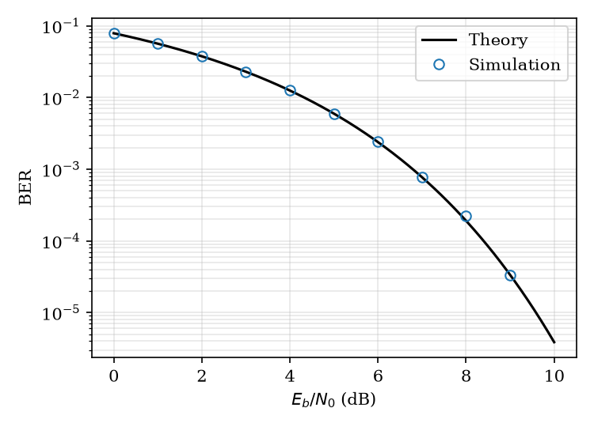

# 01 BPSK 位元錯誤率曲線

**你會做出來的東西**：一條 BPSK 在白高斯雜訊 (Additive White Gaussian Noise, AWGN) 下的 BER 曲線，模擬點要落在理論線上。



**為什麼值得做**：每一篇通訊論文的效能圖都是這個套路——產生位元、調變、加雜訊、判決、數錯誤。這 20 行搞懂之後，換成 QPSK、加上衰落通道，都只是改其中一步。

## 要做的事

打開 `ber.py`，填三個 TODO：

| TODO | 做什麼 | 卡住時想一想 |
|---|---|---|
| 1 | 位元 0/1 對應到符號 -1/+1 | 一行算式就夠，不用 if |
| 2 | 算雜訊標準差，加雜訊 | Eb = 1；雜訊每維變異數是 N0/2；Eb/N0 是比值不是 dB |
| 3 | 判決並算錯誤率 | `received > 0` 會給你什麼型別？ |

## 執行

```bash
cd ~/study/handson/01_bpsk_ber
uv run check.py        # 每個 Eb/N0 都要是 [ok]，圖會存成 ber.png
```

真的卡住再看 `.solution/ber.py`，或執行 `uv run check.py --ref` 看參考結果。

## 做完可以延伸

- 改成 QPSK（每個符號 2 位元），BER 曲線會變嗎？為什麼？
- 在 TODO 2 前乘上一個 Rayleigh 衰落係數，曲線斜率變成什麼樣子？
- 為什麼 10 dB 那一點模擬不出來？要跑多少位元才夠？（提示：看 check.py 的誤差容許範圍）
